<!--
  ⚠️ Este README é gerado automaticamente todos os dias pelo workflow "Perfil dinâmico".
  Para editar o conteúdo, altere .github/readme/template.md (e não o README.md).
  Temas e datas comemorativas ficam em .github/scripts/temas.py.
-->
<div align="center">
  

  <a href="https://git.io/typing-svg">
    
  </a>

  <p>
    <a href="https://www.linkedin.com/in/guilherme-batistela-machado/"></a>
    <a href="https://gbm-mkt.netlify.app"></a>
    <a href="https://mypersonallinks.netlify.app"></a>
    <a href="https://instagram.com/gbm_clicks"></a>
  </p>
  <p>
    
    
    
  </p>
</div>

<br />

<div align="center">
  
</div>

<br />

```sys
┌──(root⚡guiibm)-[~/profile]
└─$ cat user_info.json
```

```json
{
  "nome": "Guilherme Batistela Machado",
  "formacao": "Análise e Desenvolvimento de Sistemas @ FATEC",
  "foco_carreira": "Segurança da Informação / Red Team",
  "stack_desenvolvimento": ["Python", "C++", "C", "PHP", "JavaScript", "Bash"],
  "domínios": ["Segurança Ofensiva", "Desenvolvimento Web", "Automação & Scripts"],
  "daily_driver": "Linux Mint",
  "local": "Ubatuba, SP, Brasil",
  "hobby": "Fotografia (@gbm_clicks)"
}
```

> **Diretório Operacional:**
> - 🎯 **Alvo**: Dominar técnicas de Segurança Ofensiva (Red Team), análise de vulnerabilidades e exploração web.
> - ⚡ **Mentalidade**: Entender como os sistemas são construídos (C, C++, PHP, JS, Python) para entender exatamente como quebrá-los e blindá-los.
> - 🤖 **Automação**: Scripts em Python e Bash para tirar do caminho todo trabalho repetitivo.
> - 🌐 **Onde me achar**: portfólio em [gbm-mkt.netlify.app](https://gbm-mkt.netlify.app) e todos os links em [mypersonallinks.netlify.app](https://mypersonallinks.netlify.app).

<br />

<div align="center">
  
  <br />
  
  <br /><br />
  
  
  
  <br />
  
  
  
</div>

<br />

<div align="center">
  <a href="https://github.com/GuiiBM/Verto-Multi-purpose-Media-Security-Processing-Suite"></a>
  <a href="https://github.com/GuiiBM/MyPersonalLinks"></a>
  <a href="https://github.com/GuiiBM/CalcularPassagens"></a>
  <a href="https://github.com/GuiiBM/MundoAgape"></a>
  <a href="https://github.com/GuiiBM/tcc"></a>
  <a href="https://github.com/GuiiBM/reguladorfinanceiro"></a>
</div>

<p align="center">
  <a href="https://gbm-mkt.netlify.app"></a>
  <a href="https://github.com/GuiiBM?tab=repositories"></a>
</p>
<p align="center"><sub>Os cards acima mostram os repositórios com commits mais recentes e são atualizados todos os dias.</sub></p>

<br />

<div align="center">
  
  
  
</div>

<br />

<div align="center">
  <picture>
    <source media="(prefers-color-scheme: dark)" srcset="https://raw.githubusercontent.com/GuiiBM/GuiiBM/output/github-snake-dark.svg" />
    <source media="(prefers-color-scheme: light)" srcset="https://raw.githubusercontent.com/GuiiBM/GuiiBM/output/github-snake.svg" />
    
  </picture>
  <p><i>Consumindo, célula por célula, cada dia de contribuição.</i></p>
</div>

<br />

<div align="center">
  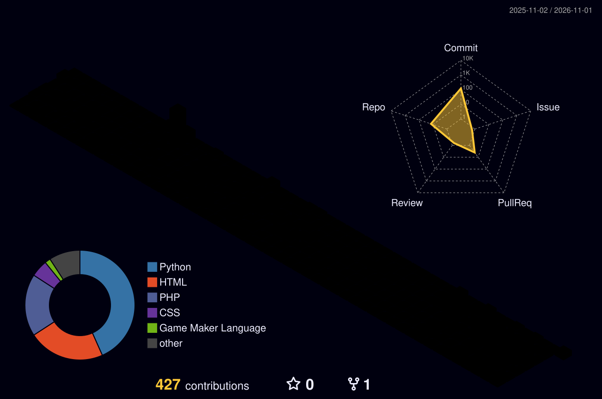
  <p><i>O histórico inteiro de commits, em perspectiva isométrica.</i></p>
</div>

<br />

<div align="center">
  
</div>

<br />

<div align="center">
  
  <p><code>"Security is not a product, but a process."</code></p>
  <p><sub>(Bruce Schneier)</sub></p>
  <sub>Atualizado em 01/11/2026 às 12:51 (horário de Brasília)</sub>
</div>
