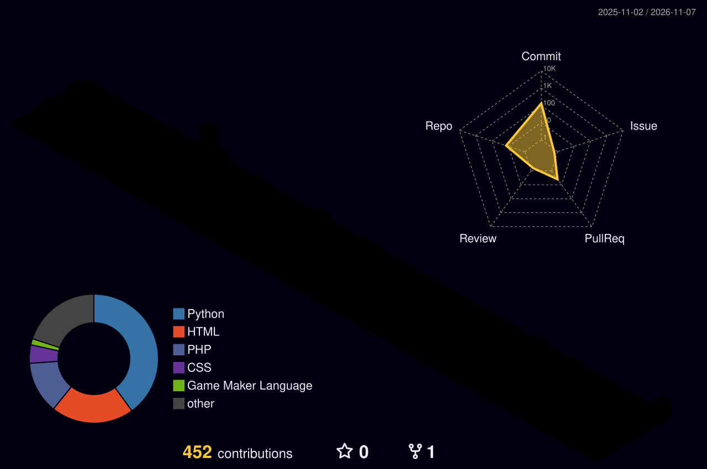

<!--
  README editável à mão. O que muda sozinho:
  - Blocos com marcadores "auto:nome" e "/auto:nome": reescritos pelo workflow
    "Perfil dinâmico" a partir de .github/scripts/curriculo.py, dos repositórios
    e do links.json. Não edite dentro deles; o bot só commita quando o texto muda.
  - Imagens e selos: publicados na branch "output", sem nenhum commit na main.
  Animações: .github/scripts/animacoes.py. Temas: .github/scripts/temas.py
-->
<div align="center">
  

  <a href="https://git.io/typing-svg">
    
  </a>

  <p>
    <a href="https://www.linkedin.com/in/guilherme-batistela-machado/"></a>
    <a href="https://gbm-mkt.netlify.app"></a>
    <a href="https://mypersonallinks.netlify.app"></a>
    <a href="https://instagram.com/gbm_mkt"></a>
    <br />
    <a href="http://lattes.cnpq.br/9693803343170549"></a>
    <a href="https://orcid.org/0009-0007-4614-9029"></a>
  </p>
  <p>
    
    
  </p>
</div>

<p align="center">
  <a href="#0x01-o-que-eu-faço"><kbd>0x01 O Que Faço</kbd></a>
  <a href="#0x02-sobre-mim"><kbd>0x02 Sobre</kbd></a>
  <a href="#0x03-trajetória"><kbd>0x03 Trajetória</kbd></a>
  <a href="#0x04-pesquisa--publicações"><kbd>0x04 Pesquisa</kbd></a>
  <a href="#0x05-formação-cursos--idiomas"><kbd>0x05 Formação</kbd></a>
  <a href="#0x06-prêmios--eventos"><kbd>0x06 Prêmios</kbd></a>
  <a href="#0x07-projetos"><kbd>0x07 Projetos</kbd></a>
  <a href="#0x08-gbm-marketing-digital"><kbd>0x08 GBM</kbd></a>
  <a href="#0x09-métricas-de-código"><kbd>0x09 Métricas</kbd></a>
  <a href="#0x0a-atividade-em-tempo-real"><kbd>0x0A Atividade</kbd></a>
  <a href="#0x0b-3d-contribuições--emblema"><kbd>0x0B 3D</kbd></a>
  <a href="#0x0c-conquistas-no-github"><kbd>0x0C Conquistas</kbd></a>
</p>

<br />


## `0x01` O Que Eu Faço

**Desenvolvimento web, automação, integração de APIs e Segurança da Informação**, com experiência prática no setor público e em projetos para empresas.

**Linguagens:** Python · C++ · C · PHP · JavaScript · HTML · CSS · Bash · MySQL

<sub><code>$ ls -la ~/arsenal</code>  ·  clique em uma linguagem para ver os repositórios dela</sub>

<p align="center">
  <a href="https://github.com/GuiiBM?tab=repositories&amp;language=python" title="Python"></a>
  <a href="https://github.com/GuiiBM?tab=repositories&amp;language=c%2B%2B" title="C++"></a>
  <a href="https://github.com/GuiiBM?tab=repositories&amp;language=c" title="C"></a>
  <a href="https://github.com/GuiiBM?tab=repositories&amp;language=php" title="PHP"></a>
  <a href="https://github.com/GuiiBM?tab=repositories&amp;language=javascript" title="JavaScript"></a>
  <a href="https://github.com/GuiiBM?tab=repositories&amp;language=html" title="HTML"></a>
  <a href="https://github.com/GuiiBM?tab=repositories&amp;language=css" title="CSS"></a>
  <a href="https://www.mysql.com" title="MySQL"></a>
  <br />
  <a href="https://linuxmint.com" title="Linux"></a>
  <a href="https://www.kali.org" title="Kali Linux"></a>
  <a href="https://github.com/GuiiBM?tab=repositories&amp;language=shell" title="Bash"></a>
  <a href="https://git-scm.com" title="Git"></a>
  <a href="https://github.com/GuiiBM" title="GitHub"></a>
  <a href="https://code.visualstudio.com" title="VS Code"></a>
  <a href="https://gbm-mkt.netlify.app" title="Netlify"></a>
</p>

<div align="center">
  
  
  
  <br />
  
  
  
</div>

### 🧰 O que eu faço, na prática

| Área | Na prática |
| --- | --- |
| 🛡️ **Segurança** | AES-256 e esteganografia no Verto, coleta OSINT, requisitos de segurança e privacidade na pesquisa, cursos da Cisco, USP e CEETEPS |
| 🌐 **Web** | PHP, JavaScript, Python com Flask, Framer e Netlify, em mais de 30 projetos entregues |
| 🔌 **APIs e integração** | e-SUS PEC com a API do WhatsApp, APIs RESTful e arquitetura orientada a serviços |
| 🤖 **Automação e IA** | Python e Bash, Selenium, Demucs, rembg e faster-whisper |
| 🖧 **Infraestrutura** | Suporte técnico, roteadores, switches, cabeamento estruturado, inventário e manuais de uso na FUNDART |
| 📋 **Contratação pública** | ETP, Termo de Referência e avaliação de Prova de Conceito para software SaaS |
| 🛰️ **Eletrônica** | Seis módulos do Ubatubasat, somando 540h de eletrônica e programação |
| 📐 **Lógica e matemática** | Quatro edições do PIC-OBMEP: combinatória, teoria dos números e geometria |

<div align="center">
  
</div>

<div align="center">
  
</div>

<br />


## `0x02` Sobre Mim

Graduando em **Análise e Desenvolvimento de Sistemas** na Fatec, bolsista de Iniciação Científica e Tecnológica (**PIBICT-CEETEPS**) e **Técnico em Informática**, formado no Ensino Médio Integrado. Atuo com desenvolvimento web, suporte e consultoria em TI, com experiência prática no setor público em soluções de automação e na elaboração de Estudos Técnicos Preliminares (ETP), Termos de Referência (TR) e avaliação de Prova de Conceito (PoC) para contratação de software SaaS.

Tenho histórico de premiações em olimpíadas científicas (medalhista e menções honrosas na OBMEP), fui bolsista do PIC-OBMEP (IMPA) e integro um projeto de pesquisa sobre a modernização e a integração de sistemas na Atenção Primária à Saúde via APIs.

> **Diretório Operacional:**
> - 🎯 **Alvo**: Dominar técnicas de Segurança Ofensiva (Red Team), análise de vulnerabilidades e exploração web.
> - ⚡ **Mentalidade**: Entender como os sistemas são construídos (C, C++, PHP, JS, Python) para entender exatamente como quebrá-los e blindá-los.
> - 🤖 **Automação**: Scripts em Python e Bash para tirar do caminho todo trabalho repetitivo.
> - 🔬 **Pesquisa**: Integrações seguras entre sistemas públicos de saúde e APIs, com contingência automatizada.
> - 🌐 **Onde me achar**: portfólio em [gbm-mkt.netlify.app](https://gbm-mkt.netlify.app) e todos os links em [mypersonallinks.netlify.app](https://mypersonallinks.netlify.app).

<div align="center">
  
</div>

<details>
  <summary><code>cat user_info.json</code> <sub>abrir a ficha em texto</sub></summary>

```json
{
  "nome": "Guilherme Batistela Machado",
  "graduacao": "Análise e Desenvolvimento de Sistemas @ Fatec São Sebastião",
  "ensino_medio": "Integrado ao Técnico em Informática",
  "pesquisa": "PIBICT-CEETEPS: integração segura do e-SUS PEC via API Meta",
  "foco_carreira": "Segurança da Informação / Red Team",
  "stack_desenvolvimento": ["Python", "C++", "C", "PHP", "JavaScript", "Bash"],
  "domínios": [
    "Segurança Ofensiva",
    "Desenvolvimento Web",
    "Automação & Scripts",
    "Integração de APIs"
  ],
  "idiomas": ["Português (nativo)", "Inglês (B1)"],
  "daily_driver": "Linux Mint",
  "lattes": "http://lattes.cnpq.br/9693803343170549",
  "orcid": "https://orcid.org/0009-0007-4614-9029",
  "instagram": "@gbm_mkt"
}
```

</details>

<br />


## `0x03` Trajetória

<sub><code>$ cat ~/trajetoria.log</code></sub>

### 📖 A história até aqui

<!-- auto:historia -->
<p><kbd>2019 a 2024</kbd> <b>Eletrônica antes de tudo</b><br />
Comecei pelo hardware. No curso Ubatubasat, na EM Pres. Tancredo de Almeida Neves, fiz seis módulos em seis anos, da eletrônica básica à programação, somando 540 horas. Foi ali que aprendi a olhar para o que existe por baixo do software.</p>

<p><kbd>2021 a 2025</kbd> <b>A matemática como treino de raciocínio</b><br />
Em 2021 veio a Medalha de Bronze na 16ª OBMEP. De 2022 a 2025, participei de quatro edições seguidas do PIC-OBMEP, no IMPA, com bolsa do CNPq, estudando análise combinatória, teoria dos números e geometria. No caminho, somei três Menções Honrosas na OBMEP e uma na Olimpíada Mandacaru.</p>

<p><kbd>2023 a 2025</kbd> <b>Do ensino técnico ao primeiro trabalho</b><br />
Enquanto cursava o Ensino Médio Integrado ao Técnico em Informática, entrei como estagiário de TI na FUNDART. Lá cuidei de suporte, redes e infraestrutura, criei um sistema próprio para a Biblioteca Municipal e ajudei a preparar a contratação do sistema definitivo em nuvem.</p>

<p><kbd>Desde 2026</kbd> <b>Fatec, pesquisa e comunidade</b><br />
Entrei em Análise e Desenvolvimento de Sistemas na Fatec São Sebastião e passei a unir código e impacto público: pesquisa em integração segura na saúde, extensão em inclusão digital e o 1º lugar na 1ª Litoral Game Jam. Tudo isso com o foco na Segurança da Informação como direção de carreira.</p>
<!-- /auto:historia -->

<div align="center">
  
</div>

### 💼 Experiências

<!-- auto:trajetoria -->
<table>
  <tr><td>
    <h3>Bolsista de Pesquisa e Desenvolvimento (PIBICT)</h3>
    <p><kbd>Desde 2026</kbd> <b>Fatec São Sebastião · CEETEPS</b></p>
    <p>Trabalho na ligação entre o sistema de saúde e o WhatsApp, para que agendamentos e avisos cheguem a quem precisa, mesmo quando a comunicação falha.</p>
    <ul>
      <li>Investigação, modelagem e implementação de integrações seguras de agendamento e notificação com o e-SUS PEC, usando a API do WhatsApp (Meta Business Platform).</li>
      <li>Mecanismos automatizados de contingência para falhas de comunicação, tratamento de exceções em tempo real e resiliência na entrega de mensagens críticas de saúde.</li>
      <li>Arquitetura orientada a serviços, consumo de APIs RESTful e análise de requisitos de segurança de dados e privacidade em sistemas públicos de saúde.</li>
    </ul>
  </td></tr>
</table>

<table>
  <tr><td>
    <h3>Projeto de Inclusão Digital para a Comunidade</h3>
    <p><kbd>Desde 2026</kbd> <b>CEETEPS (extensão)</b></p>
    <p>Levo informática básica e ferramentas digitais para quem está começando, ajudando a desenvolver competências tecnológicas na comunidade.</p>
    <ul>
      <li>Apoio à gestão e ao planejamento pedagógico do curso.</li>
      <li>Divulgação e marketing das turmas.</li>
      <li>Monitoria presencial em sala de aula.</li>
    </ul>
  </td></tr>
</table>

<table>
  <tr><td>
    <h3>Estagiário Técnico em Informática</h3>
    <p><kbd>2024 a 2025</kbd> <b>FUNDART · Fundação de Arte e Cultura de Ubatuba</b></p>
    <p>Foi a minha escola de TI na prática: do chamado de suporte à infraestrutura, e do código ao processo de contratação pública.</p>
    <ul>
      <li>Suporte técnico presencial e remoto: formatação e manutenção de computadores, softwares corporativos, e-mails institucionais, redes e impressoras.</li>
      <li>Diagnóstico e manutenção de hardware, roteadores, switches e cabeamento estruturado.</li>
      <li>Inventário de hardware e software e manuais de uso para os funcionários.</li>
      <li>Desenvolvimento de um sistema próprio de suporte transitório para o controle da Biblioteca Municipal.</li>
      <li>Levantamento de requisitos, ETP, Termo de Referência e avaliação de Prova de Conceito para contratar e migrar o sistema definitivo em nuvem (SaaS).</li>
    </ul>
  </td></tr>
</table>

<table>
  <tr><td>
    <h3>Iniciação Científica Júnior (PIC-OBMEP)</h3>
    <p><kbd>2022 a 2025</kbd> <b>IMPA · CNPq</b></p>
    <p>Quatro edições seguidas de estudo aprofundado, a partir do desempenho na olimpíada de matemática, com bolsa de Iniciação Científica Júnior do CNPq.</p>
    <ul>
      <li>Participação consecutiva nas edições 16, 17, 18 e 19 do programa, com bolsa do CNPq.</li>
      <li>Matemática avançada, raciocínio lógico, análise combinatória, teoria dos números, geometria e resolução de problemas.</li>
    </ul>
  </td></tr>
</table>
<!-- /auto:trajetoria -->

<br />


## `0x04` Pesquisa & Publicações

<sub><code>$ grep -r 'e-SUS PEC' ~/pesquisa</code></sub>

O que estudo, explicado sem jargão.

### 🔬 Os projetos

<!-- auto:pesquisa -->
<table>
  <tr><td colspan="2"><h3>🏥 Modernização da Gestão de Fluxos e Agendamentos na Atenção Primária à Saúde de São Sebastião</h3><p><i>Integração segura ao e-SUS PEC via API Meta e mecanismos de contingência automatizados.</i></p></td></tr>
  <tr><td><b>O que é</b></td><td>Uma pesquisa sobre como tornar mais ágeis os agendamentos e os fluxos de atendimento na Atenção Primária à Saúde de São Sebastião, conectando o e-SUS PEC, o Prontuário Eletrônico do Cidadão, à API do WhatsApp da plataforma Meta Business.</td></tr>
  <tr><td><b>Como funciona</b></td><td>O sistema de saúde e a API conversam por uma camada de integração segura, baseada em APIs RESTful e em uma arquitetura orientada a serviços, que leva agendamentos e notificações até o paciente.</td></tr>
  <tr><td><b>Quando algo falha</b></td><td>Mensagens de saúde são críticas e não podem se perder em silêncio. Por isso, mecanismos automatizados de contingência tratam as exceções em tempo real e dão resiliência à entrega.</td></tr>
  <tr><td><b>Onde entra a segurança</b></td><td>Por lidar com dados de saúde em um sistema público, o projeto analisa os requisitos de segurança de dados e de privacidade como parte da própria integração.</td></tr>
</table>

<br />

<table>
  <tr><td colspan="2"><h3>📐 Programa de Iniciação Científica Júnior: PIC/OBMEP</h3><p><i>Programa do IMPA, com apoio do CNPq, para quem se destaca na OBMEP.</i></p></td></tr>
  <tr><td><b>O que é</b></td><td>Um programa de desenvolvimento de aptidões em matemática avançada, do qual participei com bolsa do CNPq.</td></tr>
  <tr><td><b>O que estudei</b></td><td>Raciocínio lógico, análise combinatória, teoria dos números, geometria e resolução de problemas.</td></tr>
</table>
<!-- /auto:pesquisa -->

### 📄 Publicação

O trabalho virou resumo nos anais do Seminário de Inovação, Ciência e Tecnologia do Litoral Norte e também foi apresentado no evento.

> MACHADO, G. B.; LOURENCO, D. F. Modernização da Gestão de Fluxos e Agendamentos na Atenção Primária à Saúde de São Sebastião: Integração Segura ao e-SUS PEC via API Meta e Mecanismos de Contingência Automatizados. In: Seminário de Inovação, Ciência e Tecnologia do Litoral Norte, 2026, Caraguatatuba. Anais [...]. Caraguatatuba: IFSP Campus Caraguatatuba, 2026.

### 🛠️ Produção técnica

Os trabalhos técnicos registrados no meu Lattes.

<!-- auto:producao -->
<table>
  <tr><th align="left">Produção</th><th align="left">O que é</th><th align="left">Ano</th></tr>
  <tr><td><b>Rosto a Rosto</b></td><td>Jogo apresentado na Game Jam, registrado como consultoria de aplicações web.</td><td><kbd>2026</kbd></td></tr>
  <tr><td><b>Soluções digitais para PMEs</b></td><td>Consultoria com infraestrutura web, dashboards financeiros e contábeis e outras soluções para pequenas e médias empresas.</td><td><kbd>2025</kbd></td></tr>
  <tr><td><b>Gestão de Empréstimos da Biblioteca Municipal</b></td><td>Sistema automatizado, de uso interno da FUNDART, para controlar os empréstimos da biblioteca.</td><td><kbd>2025</kbd></td></tr>
  <tr><td><b>ETP, TR e PoC para software de biblioteca</b></td><td>Assessoramento técnico, com M. F. Aranha, na elaboração do Estudo Técnico Preliminar e do Termo de Referência e na avaliação da Prova de Conceito.</td><td><kbd>2024</kbd></td></tr>
</table>
<!-- /auto:producao -->

<sub>Tudo com fonte no <a href="http://lattes.cnpq.br/9693803343170549">Currículo Lattes</a> e no <a href="https://orcid.org/0009-0007-4614-9029">ORCID</a>.</sub>

<br />


## `0x05` Formação, Cursos & Idiomas

<sub><code>$ ls ~/certificados</code></sub>

### 🎓 Formação acadêmica

Primeiro o Ensino Médio Integrado ao Técnico em Informática, e depois a graduação em Análise e Desenvolvimento de Sistemas na Fatec.

<!-- auto:formacao -->
<table>
  <tr><th align="left">Curso</th><th align="left">Instituição</th><th align="left">Período</th></tr>
  <tr><td><b>Análise e Desenvolvimento de Sistemas (graduação)</b></td><td>Fatec São Sebastião · CEETEPS</td><td><kbd>Desde 2026</kbd></td></tr>
  <tr><td><b>Ensino Médio Integrado ao Técnico em Informática</b></td><td>EM Pres. Tancredo de Almeida Neves</td><td><kbd>2023 a 2025</kbd></td></tr>
</table>
<!-- /auto:formacao -->

### 🌐 Idiomas

Sou certificado pelo CCAA no nível B1 de inglês e tenho a certificação de proficiência em Aviation English Level 3.

<!-- auto:idiomas -->
<table>
  <tr><th align="left">Idioma</th><th align="left">Nível</th><th align="left">Comprovação</th></tr>
  <tr><td><b>Português</b></td><td>Nativo</td><td>Língua materna</td></tr>
  <tr><td><b>Inglês</b></td><td>Intermediário (B1)</td><td>Certificado pelo CCAA · 152h · 2024 a 2025</td></tr>
  <tr><td><b>Inglês aeronáutico</b></td><td>Aviation English Level 3</td><td>STP TRAINAIR PLUS OACI · ANAC · 2026</td></tr>
</table>
<!-- /auto:idiomas -->

### 📜 Formação complementar

Os cursos que escolhi fazer por fora, ligados ao que quero construir na carreira.

<!-- auto:cursos -->
<details open>
  <summary><b>🛡️ Cibersegurança</b> <sub>4 cursos · 48h</sub></summary>
  <p>A base do meu foco em Segurança da Informação: fundamentos, ataques cibernéticos e conscientização, com a Cisco, a USP e o CEETEPS.</p>

<table>
  <tr><th align="left">Curso</th><th align="left">Instituição</th><th align="left">Carga</th><th align="left">Ano</th></tr>
  <tr><td>Introduction to Information Security (Edital ARI 004/2026)</td><td>CEETEPS</td><td>40h</td><td><kbd>2026</kbd></td></tr>
  <tr><td>Cibersegurança: Segurança da Informação e Ataques Cibernéticos</td><td>USP</td><td>8h</td><td><kbd>2026</kbd></td></tr>
  <tr><td>Introduction to Cybersecurity</td><td>Cisco Networking Academy</td><td>—</td><td><kbd>2026</kbd></td></tr>
  <tr><td>Sensibilização para a Segurança Digital</td><td>Cisco Networking Academy</td><td>—</td><td><kbd>2026</kbd></td></tr>
</table>
</details>
<details>
  <summary><b>💻 Programação</b> <sub>3 cursos · 48h</sub></summary>
  <p>C para entender o que acontece perto da máquina, game jam para entregar com prazo curto e mentoria técnica para crescer na profissão.</p>

<table>
  <tr><th align="left">Curso</th><th align="left">Instituição</th><th align="left">Carga</th><th align="left">Ano</th></tr>
  <tr><td>Introduction to the C Programming Language (Edital ARI 027/2026)</td><td>CEETEPS</td><td>40h</td><td><kbd>2026</kbd></td></tr>
  <tr><td>Conexão Game Jam 2026</td><td>CEETEPS</td><td>8h</td><td><kbd>2026</kbd></td></tr>
  <tr><td>Tech Mentoring: Mentoria Técnica Profissional</td><td>Vinicius Senger</td><td>—</td><td><kbd>2025 a 2026</kbd></td></tr>
</table>
</details>
<details>
  <summary><b>🛰️ Ubatubasat: eletrônica e programação</b> <sub>6 cursos · 540h</sub></summary>
  <p>Seis módulos, um por ano, que me levaram da eletrônica básica à programação.</p>

<table>
  <tr><th align="left">Curso</th><th align="left">Instituição</th><th align="left">Carga</th><th align="left">Ano</th></tr>
  <tr><td>Módulo 6: Eletrônica e Programação</td><td>EM Pres. Tancredo de Almeida Neves</td><td>90h</td><td><kbd>2024</kbd></td></tr>
  <tr><td>Módulo 5: Eletrônica e Programação</td><td>EM Pres. Tancredo de Almeida Neves</td><td>90h</td><td><kbd>2023</kbd></td></tr>
  <tr><td>Módulo 4: Eletrônica e Programação</td><td>EM Pres. Tancredo de Almeida Neves</td><td>90h</td><td><kbd>2022</kbd></td></tr>
  <tr><td>Módulo 3: Eletrônica e Programação</td><td>EM Pres. Tancredo de Almeida Neves</td><td>90h</td><td><kbd>2021</kbd></td></tr>
  <tr><td>Módulo 2: Eletrônica Básica</td><td>EM Pres. Tancredo de Almeida Neves</td><td>90h</td><td><kbd>2020</kbd></td></tr>
  <tr><td>Módulo 1: Eletrônica Básica</td><td>EM Pres. Tancredo de Almeida Neves</td><td>90h</td><td><kbd>2019</kbd></td></tr>
</table>
</details>
<!-- /auto:cursos -->

<br />


## `0x06` Prêmios & Eventos

<sub><code>$ cat ~/premios.txt</code></sub>

### 🏆 Prêmios e destaques

Da matemática à robótica, passando pela aviação e pelos jogos.

<!-- auto:premios -->
<table>
  <tr><th align="left"></th><th align="left">Prêmio ou destaque</th><th align="left">Onde</th><th align="left">Ano</th></tr>
  <tr><td>🥇</td><td><b>1º lugar na 1ª Litoral Game Jam</b></td><td>6ª Expo Game Jam · Fatec, polo São Sebastião</td><td><kbd>2026</kbd></td></tr>
  <tr><td>✨</td><td><b>Aprovação na avaliação teórica de Piloto de Drone (RPAS)</b></td><td>ANAC</td><td><kbd>2026</kbd></td></tr>
  <tr><td>✨</td><td><b>Proficiência em Aviation English Level 3</b></td><td>STP TRAINAIR PLUS OACI · ANAC</td><td><kbd>2026</kbd></td></tr>
  <tr><td>✨</td><td><b>Resumo publicado e apresentado no SICLN 2026</b></td><td>IFSP Caraguatatuba · e-SUS PEC + API Meta</td><td><kbd>2026</kbd></td></tr>
  <tr><td>✨</td><td><b>Avaliação técnica e arbitragem na OBR</b></td><td>Olimpíada Brasileira de Robótica · etapa regional</td><td><kbd>2026</kbd></td></tr>
  <tr><td>🎖️</td><td><b>Menção Honrosa na 20ª OBMEP</b></td><td>IMPA</td><td><kbd>2025</kbd></td></tr>
  <tr><td>🎖️</td><td><b>Menção Honrosa na 19ª OBMEP</b></td><td>IMPA</td><td><kbd>2024</kbd></td></tr>
  <tr><td>🎖️</td><td><b>Menção Honrosa na 18ª OBMEP</b></td><td>IMPA</td><td><kbd>2023</kbd></td></tr>
  <tr><td>🎖️</td><td><b>Menção Honrosa na 3ª Olimpíada Mandacaru de Matemática</b></td><td>Comitê Organizador</td><td><kbd>2023</kbd></td></tr>
  <tr><td>🥉</td><td><b>Medalha de Bronze na 16ª OBMEP</b></td><td>IMPA</td><td><kbd>2021</kbd></td></tr>
</table>
<!-- /auto:premios -->

### 🎪 Eventos e olimpíadas

Participo de olimpíadas desde 2021 e, mais recentemente, também de congresso, seminário e feira de tecnologia, levando jogos e pesquisa.

<!-- auto:eventos -->
<details>
  <summary><b>Ver os 12 eventos e olimpíadas</b></summary>

<table>
  <tr><th align="left">Evento</th><th align="left">Tipo</th><th align="left">Ano</th></tr>
  <tr><td>1ª Conexão Game Jam · 1ª Litoral Game Jam · 6ª Expo Game Jam, com os jogos Paradoxo de Wilson e Rosto a Rosto</td><td><code>Feira</code></td><td><kbd>2026</kbd></td></tr>
  <tr><td>Seminário de Inovação, Ciência e Tecnologia do Litoral Norte (SICLN 2026)</td><td><code>Simpósio</code></td><td><kbd>2026</kbd></td></tr>
  <tr><td>5º Encontro do Clube da Robótica</td><td><code>Seminário</code></td><td><kbd>2026</kbd></td></tr>
  <tr><td>The Developer&#x27;s Conference (TDC 2025)</td><td><code>Congresso</code></td><td><kbd>2025</kbd></td></tr>
  <tr><td>OBMEP 2025</td><td><code>Olimpíada</code></td><td><kbd>2025</kbd></td></tr>
  <tr><td>OBMEP 2024</td><td><code>Olimpíada</code></td><td><kbd>2024</kbd></td></tr>
  <tr><td>Olimpíada Brasileira de Astronomia e Astronáutica (OBA 2024)</td><td><code>Olimpíada</code></td><td><kbd>2024</kbd></td></tr>
  <tr><td>OBMEP 2023</td><td><code>Olimpíada</code></td><td><kbd>2023</kbd></td></tr>
  <tr><td>Olimpíada Mandacaru de Matemática (3ª edição)</td><td><code>Olimpíada</code></td><td><kbd>2023</kbd></td></tr>
  <tr><td>OBMEP 2022</td><td><code>Olimpíada</code></td><td><kbd>2022</kbd></td></tr>
  <tr><td>Olimpíada Brasileira de Astronomia e Astronáutica (OBA 2022)</td><td><code>Olimpíada</code></td><td><kbd>2022</kbd></td></tr>
  <tr><td>OBMEP 2021</td><td><code>Olimpíada</code></td><td><kbd>2021</kbd></td></tr>
</table>
</details>
<!-- /auto:eventos -->

<br />


## `0x07` Projetos

<sub><code>$ git log --oneline --recent</code></sub>

### ⭐ Destaques

<!-- auto:destaques -->
<table>
<tr><td width="50%" valign="top"><h4>Verto</h4><p>Suíte local-first com 40 ferramentas de IA, criptografia, binários e mídia. Os dados sensíveis ficam na máquina do usuário.</p><p><code>Python</code> <code>Flask</code> <code>Demucs</code> <code>rembg</code> <code>faster-whisper</code> <code>AES-256</code> <code>yt-dlp</code></p><p><a href="https://github.com/GuiiBM/Verto-Multi-purpose-Media-Security-Processing-Suite">Código</a></p></td><td width="50%" valign="top"><h4>Massive OSINT Framework</h4><p>Coleta de dados públicos (OSINT) em múltiplas fontes e automação de comunicação via WhatsApp Web.</p><p><code>Python</code> <code>Selenium</code> <code>BeautifulSoup4</code> <code>Pandas</code> <code>Pillow</code></p><p><a href="https://github.com/GuiiBM/Massive-OSINT-Communication-Framework">Código</a></p></td></tr>
<tr><td width="50%" valign="top"><h4>Ressonance</h4><p>Meu TCC: plataforma de música com um algoritmo diferente, com artistas, álbuns, playlists, podcasts, recomendações e login social.</p><p><code>PHP</code> <code>JavaScript</code> <code>CSS</code> <code>OAuth</code></p><p><a href="https://github.com/GuiiBM/tcc">Código</a> · <a href="https://ressonance.hyperphp.com/">Site no ar</a></p></td><td width="50%" valign="top"><h4>Regulador Financeiro</h4><p>Monitoramento de mercado com atraso de 15 min: ações e FIIs, carteira, recomendações, análise técnica e dividendos.</p><p><code>Python</code> <code>Flask</code> <code>SQLite</code> <code>yfinance</code> <code>pandas</code> <code>APScheduler</code></p><p><a href="https://github.com/GuiiBM/reguladorfinanceiro">Código</a></p></td></tr>
<tr><td width="50%" valign="top"><h4>Calcula Passagem</h4><p>Soma as viagens de ônibus entre Ubatuba, Caraguatatuba e São Sebastião e mostra quanto colocar no cartão.</p><p><code>HTML</code> <code>JavaScript</code> <code>Netlify</code></p><p><a href="https://github.com/GuiiBM/CalcularPassagens">Código</a> · <a href="https://calcularpassagens.netlify.app/">Site no ar</a></p></td><td width="50%" valign="top"><h4>Mundo Ágape</h4><p>Site do ministério infantil da Igreja Ágape, com lições, fotos, eventos e recursos em um só lugar.</p><p><code>HTML</code> <code>CSS</code> <code>JavaScript</code></p><p><a href="https://github.com/GuiiBM/MundoAgape">Código</a> · <a href="https://mundoagape.netlify.app/">Site no ar</a></p></td></tr>
</table>
<!-- /auto:destaques -->

### 🕒 Mexidos por último

<sub>Os repositórios com push mais recente, atualizados sozinhos.</sub>

<!-- auto:projetos -->
<table>
  <tr><th align="left">Projeto</th><th align="left">O que é</th><th align="left">Linguagem</th><th align="left">Último commit</th></tr>
  <tr><td><a href="https://github.com/GuiiBM/Verto-Multi-purpose-Media-Security-Processing-Suite"><b>Verto-Multi-purpose-Media-Security-Processing-Suite</b></a></td><td>Suíte local-first com 40 ferramentas de IA, criptografia, binários e mídia.</td><td><a href="https://github.com/GuiiBM?tab=repositories&amp;language=python"><code>Python</code></a></td><td></td></tr>
  <tr><td><a href="https://github.com/GuiiBM/MyPersonalLinks"><b>MyPersonalLinks</b></a></td><td>Projetos, sites e experimentos reunidos num só lugar.</td><td><a href="https://github.com/GuiiBM?tab=repositories&amp;language=html"><code>HTML</code></a></td><td></td></tr>
  <tr><td><a href="https://github.com/GuiiBM/CalcularPassagens"><b>CalcularPassagens</b></a></td><td>Some suas viagens de ônibus entre Ubatuba, Caraguatatuba e São Sebastião e veja quanto colocar no cartão.</td><td><a href="https://github.com/GuiiBM?tab=repositories&amp;language=html"><code>HTML</code></a></td><td></td></tr>
  <tr><td><a href="https://github.com/GuiiBM/MundoAgape"><b>MundoAgape</b></a></td><td>Ministério infantil da Igreja Ágape. Lições, fotos, eventos e recursos do Mundo Ágape em um só lugar.</td><td><a href="https://github.com/GuiiBM?tab=repositories&amp;language=css"><code>CSS</code></a></td><td></td></tr>
  <tr><td><a href="https://github.com/GuiiBM/tcc"><b>tcc</b></a></td><td>Ressonance, meu TCC: plataforma de música com um algoritmo diferente.</td><td><a href="https://github.com/GuiiBM?tab=repositories&amp;language=php"><code>PHP</code></a></td><td></td></tr>
  <tr><td><a href="https://github.com/GuiiBM/reguladorfinanceiro"><b>reguladorfinanceiro</b></a></td><td>Aplicação web de monitoramento de mercado financeiro em tempo real (atraso de 15 min), com compra/venda de ações e FIIs, carteira, recomendações, análise técnica e dividendos.</td><td><a href="https://github.com/GuiiBM?tab=repositories&amp;language=html"><code>HTML</code></a></td><td></td></tr>
</table>
<!-- /auto:projetos -->

<!-- auto:todos -->
<details>
  <summary><b>Ver todos os 13 repositórios públicos</b></summary>

<table>
  <tr><th align="left">Repositório</th><th align="left">O que é</th><th align="left">Linguagem</th></tr>
  <tr><td><a href="https://github.com/GuiiBM/baixar-video-youtube-python"><b>baixar-video-youtube-python</b></a></td><td>Aplicação web para baixar vídeos do YouTube com seleção de qualidade.</td><td><a href="https://github.com/GuiiBM?tab=repositories&amp;language=python"><code>Python</code></a></td></tr>
  <tr><td><a href="https://github.com/GuiiBM/CalcularPassagens"><b>CalcularPassagens</b></a></td><td>Some suas viagens de ônibus entre Ubatuba, Caraguatatuba e São Sebastião e veja quanto colocar no cartão.</td><td><a href="https://github.com/GuiiBM?tab=repositories&amp;language=html"><code>HTML</code></a></td></tr>
  <tr><td><a href="https://github.com/GuiiBM/Massive-OSINT-Communication-Framework"><b>Massive-OSINT-Communication-Framework</b></a></td><td>Coleta de dados públicos (OSINT) e automação de comunicação via WhatsApp Web.</td><td><a href="https://github.com/GuiiBM?tab=repositories&amp;language=python"><code>Python</code></a></td></tr>
  <tr><td><a href="https://github.com/GuiiBM/MundoAgape"><b>MundoAgape</b></a></td><td>Ministério infantil da Igreja Ágape. Lições, fotos, eventos e recursos do Mundo Ágape em um só lugar.</td><td><a href="https://github.com/GuiiBM?tab=repositories&amp;language=css"><code>CSS</code></a></td></tr>
  <tr><td><a href="https://github.com/GuiiBM/MyPersonalLinks"><b>MyPersonalLinks</b></a></td><td>Projetos, sites e experimentos reunidos num só lugar.</td><td><a href="https://github.com/GuiiBM?tab=repositories&amp;language=html"><code>HTML</code></a></td></tr>
  <tr><td><a href="https://github.com/GuiiBM/NegativeAnswer"><b>NegativeAnswer</b></a></td><td>Negative Answer</td><td><a href="https://github.com/GuiiBM?tab=repositories&amp;language=html"><code>HTML</code></a></td></tr>
  <tr><td><a href="https://github.com/GuiiBM/Pokedex-gen1"><b>Pokedex-gen1</b></a></td><td>Pokedex com os 151 Pokémon (q-developer-quest-tdc-2025)</td><td><a href="https://github.com/GuiiBM?tab=repositories&amp;language=php"><code>PHP</code></a></td></tr>
  <tr><td><a href="https://github.com/GuiiBM/Python---Soma-de-Gauus"><b>Python---Soma-de-Gauus</b></a></td><td><sub>Sem descrição por enquanto.</sub></td><td><a href="https://github.com/GuiiBM?tab=repositories&amp;language=python"><code>Python</code></a></td></tr>
  <tr><td><a href="https://github.com/GuiiBM/reguladorfinanceiro"><b>reguladorfinanceiro</b></a></td><td>Aplicação web de monitoramento de mercado financeiro em tempo real (atraso de 15 min), com compra/venda de ações e FIIs, carteira, recomendações, análise técnica e dividendos.</td><td><a href="https://github.com/GuiiBM?tab=repositories&amp;language=html"><code>HTML</code></a></td></tr>
  <tr><td><a href="https://github.com/GuiiBM/Ressonance"><b>Ressonance</b></a></td><td>Uma plataforma de música com um algoritmo diferente</td><td><a href="https://github.com/GuiiBM?tab=repositories&amp;language=php"><code>PHP</code></a></td></tr>
  <tr><td><a href="https://github.com/GuiiBM/tcc"><b>tcc</b></a></td><td>Ressonance, meu TCC: plataforma de música com um algoritmo diferente.</td><td><a href="https://github.com/GuiiBM?tab=repositories&amp;language=php"><code>PHP</code></a></td></tr>
  <tr><td><a href="https://github.com/GuiiBM/translatorauto"><b>translatorauto</b></a></td><td>Tradutor de Conversa</td><td><a href="https://github.com/GuiiBM?tab=repositories&amp;language=html"><code>HTML</code></a></td></tr>
  <tr><td><a href="https://github.com/GuiiBM/Verto-Multi-purpose-Media-Security-Processing-Suite"><b>Verto-Multi-purpose-Media-Security-Processing-Suite</b></a></td><td>Suíte local-first com 40 ferramentas de IA, criptografia, binários e mídia.</td><td><a href="https://github.com/GuiiBM?tab=repositories&amp;language=python"><code>Python</code></a></td></tr>
</table>
</details>
<!-- /auto:todos -->

### 📡 Radar de repositórios

<div align="center">
  
</div>

<p align="center">
  <a href="https://github.com/GuiiBM?tab=repositories"></a>
</p>

<br />


## `0x08` GBM Marketing Digital

<sub><code>$ curl -s gbm-mkt.netlify.app</code></sub>

**Estratégia, design e código no mesmo lugar.** Na GBM eu cuido de cada projeto do começo ao fim, com atendimento direto e sem intermediários: sites profissionais, Instagram e identidade visual. São **mais de 30 projetos entregues** e **mais de 4 anos de experiência**.

<!-- auto:servicos -->
<p align="center">
  <kbd>Desenvolvimento Web</kbd>
  <kbd>Design Visual</kbd>
  <kbd>Programação</kbd>
  <kbd>Gerenciamento de Conteúdo</kbd>
  <kbd>Prototipagem Digital</kbd>
  <kbd>Design UI/UX</kbd>
  <kbd>Design Gráfico</kbd>
  <kbd>Edição de Imagens</kbd>
</p>
<!-- /auto:servicos -->

### 🚀 Sites e projetos no ar

<sub>Lista vinda do meu <a href="https://mypersonallinks.netlify.app">MyPersonalLinks</a>, atualizada sozinha.</sub>

<!-- auto:sites -->
<details open>
  <summary><b>🧑‍💻 Projetos pessoais</b> <sub>4</sub></summary>

<table>
  <tr><th align="left">Site</th><th align="left">O que é</th></tr>
  <tr><td><a href="https://gbm-mkt.netlify.app/"><b>GBM Marketing</b></a></td><td>Meu Portfólio Particular</td></tr>
  <tr><td><a href="https://ressonance.hyperphp.com/"><b>Ressonance</b></a></td><td>Meu TCC</td></tr>
  <tr><td><a href="https://calcularpassagens.netlify.app/"><b>Calcular Passagens</b></a></td><td>Website voltado para cálculo de passagens de Ubatuba-São Sebastião</td></tr>
  <tr><td><a href="https://5505e5506.netlify.app/"><b>5505 e 5506</b></a></td><td>Horários ao vivo das linhas 5505 e 5506 entre São Sebastião, Caraguatatuba e Ubatuba</td></tr>
</table>
</details>
<details>
  <summary><b>🏢 Sites para empresas e marcas</b> <sub>5</sub></summary>

<table>
  <tr><th align="left">Site</th><th align="left">O que é</th></tr>
  <tr><td><a href="https://juniorgouvea.framer.website/"><b>Reginaldo Gouvea Junior</b></a></td><td>Website voltado para exposição da empresa Junior Gouvea</td></tr>
  <tr><td><a href="https://twbteacherwillians.netlify.app/"><b>TWB Website</b></a></td><td>Website voltado para exposição da empresa Teacher WIllians Batistela</td></tr>
  <tr><td><a href="https://locandaimes.framer.website/"><b>Loc Andaimes Website</b></a></td><td>Website voltado para exposição da empresa Loc Andaimes</td></tr>
  <tr><td><a href="https://relicario.framer.website/"><b>Relicário</b></a></td><td>Website voltado para exposição da empresa Relicário P2</td></tr>
  <tr><td><a href="https://gomei.framer.website/"><b>GoMei</b></a></td><td>Website voltado para exposição da empresa Gomei</td></tr>
</table>
</details>
<details>
  <summary><b>🗄️ Sites com banco de dados</b> <sub>2</sub></summary>

<table>
  <tr><th align="left">Site</th><th align="left">O que é</th></tr>
  <tr><td><a href="https://integracaoagape.netlify.app/"><b>Planilha Ágape</b></a></td><td>Formulário Simplificado da Igreja Apostólica Ágape com acesso ao Banco de Dados</td></tr>
  <tr><td><a href="https://mundoagape.netlify.app/"><b>Mundo Ágape</b></a></td><td>Website voltado para exposição das fotos do ministério Mundo Ágape</td></tr>
</table>
</details>
<details>
  <summary><b>🎮 Entretenimento e utilidades</b> <sub>5</sub></summary>

<table>
  <tr><th align="left">Site</th><th align="left">O que é</th></tr>
  <tr><td><a href="https://jogarcaraacara.netlify.app/"><b>Cara a Cara</b></a></td><td>Jogo Cara a Cara Online</td></tr>
  <tr><td><a href="https://estigmas.netlify.app/"><b>Estigmas</b></a></td><td>Calendário com sugestões de autoaprimoramento</td></tr>
  <tr><td><a href="https://negativeanswer.netlify.app/"><b>Non-Sense Maker &#x27;Não&#x27;</b></a></td><td>Um gerador automático de frases que compõe e dizem &#x27;Não&#x27;</td></tr>
  <tr><td><a href="https://conversoes.netlify.app/"><b>Conversor</b></a></td><td>Website voltado para conversões de medidas brasileiras e americanas</td></tr>
  <tr><td><a href="https://ohack.netlify.app/"><b>O Hack</b></a></td><td>Site para entretenimento e geração de caracteres aleatórios</td></tr>
</table>
</details>
<!-- /auto:sites -->

### 📱 Perfis de Instagram que eu cuido

<!-- auto:perfis -->
<table>
  <tr><th align="left">Perfil</th><th align="left">Marca</th><th align="left">Trabalho</th></tr>
  <tr><td><a href="https://instagram.com/gbm_mkt"><code>@gbm_mkt</code></a></td><td>GBM Marketing Digital</td><td>Perfil oficial, com cases e novidades</td></tr>
  <tr><td><a href="https://instagram.com/loc_andaimes_"><code>@loc_andaimes_</code></a></td><td>Loc Andaimes</td><td>Gerenciamento completo do Instagram</td></tr>
  <tr><td><a href="https://instagram.com/junior.bgouvea"><code>@junior.bgouvea</code></a></td><td>Reginaldo Bueno de Gouvêa Junior</td><td>Posts, iLinks e website</td></tr>
  <tr><td><a href="https://instagram.com/felipej.consultor"><code>@felipej.consultor</code></a></td><td>Felipe João</td><td>Posts e iLinks</td></tr>
  <tr><td><a href="https://instagram.com/twbteacherwillians"><code>@twbteacherwillians</code></a></td><td>Teacher Willians Batistela</td><td>Posts de divulgação de cursos e aulas</td></tr>
  <tr><td><a href="https://instagram.com/oliveira_bicicletaria"><code>@oliveira_bicicletaria</code></a></td><td>Bicicletaria Oliveira</td><td>Posts desenvolvidos pela GBM</td></tr>
</table>
<!-- /auto:perfis -->

<p align="center">
  <a href="https://gbm-mkt.netlify.app"></a>
  <a href="mailto:contato@gbm-mkt.com"></a>
</p>

<br />


## `0x09` Métricas de Código

<sub><code>$ gh stats --last-12-months</code>  ·  contribuições, commits, PRs e issues dos últimos 12 meses; clique em um número para abrir</sub>

<p align="center">
  <a href="https://github.com/GuiiBM"></a>
  <a href="https://github.com/search?q=author%3AGuiiBM&amp;type=commits"></a>
  <a href="https://github.com/search?q=author%3AGuiiBM+type%3Apr&amp;type=pullrequests"></a>
  <a href="https://github.com/search?q=author%3AGuiiBM+type%3Aissue&amp;type=issues"></a>
  <a href="https://github.com/GuiiBM?tab=repositories"></a>
  <a href="https://github.com/GuiiBM?tab=repositories&amp;sort=stargazers"></a>
  <a href="https://github.com/GuiiBM"></a>
  <a href="https://github.com/GuiiBM"></a>
</p>

<div align="center">
  
  
</div>

<br />


## `0x0A` Atividade em Tempo Real

<sub><code>$ tail -f ~/contributions.log</code></sub>

<div align="center">
  <picture>
    <source media="(prefers-color-scheme: dark)" srcset="https://raw.githubusercontent.com/GuiiBM/GuiiBM/output/github-snake-dark.svg" />
    <source media="(prefers-color-scheme: light)" srcset="https://raw.githubusercontent.com/GuiiBM/GuiiBM/output/github-snake.svg" />
    
  </picture>
  <p><i>Consumindo, célula por célula, cada dia de contribuição.</i></p>
</div>

<br />


## `0x0B` 3D: Contribuições & Emblema

<sub><code>$ render --isometric --year</code></sub>

<div align="center">
  
  <p><i>O histórico de contribuições, em perspectiva isométrica.</i></p>
</div>

<!-- auto:emblema -->
<details>
  <summary><b>🧊 Abrir o emblema GBM em 3D</b> <sub>arraste para girar, role para aproximar</sub></summary>

```stl
solid gbm
facet normal 0 0 1
outer loop
vertex 3.18e-15 52 3
vertex -45 26 3
vertex -45 -26 3
endloop
endfacet
facet normal 0 0 -1
outer loop
vertex 3.18e-15 52 0
vertex -45 -26 0
vertex -45 26 0
endloop
endfacet
facet normal 0 0 1
outer loop
vertex 3.18e-15 52 3
vertex -45 -26 3
vertex -9.55e-15 -52 3
endloop
endfacet
facet normal 0 0 -1
outer loop
vertex 3.18e-15 52 0
vertex -9.55e-15 -52 0
vertex -45 -26 0
endloop
endfacet
facet normal 0 0 1
outer loop
vertex 3.18e-15 52 3
vertex -9.55e-15 -52 3
vertex 45 -26 3
endloop
endfacet
facet normal 0 -0 -1
outer loop
vertex 3.18e-15 52 0
vertex 45 -26 0
vertex -9.55e-15 -52 0
endloop
endfacet
facet normal 0 0 1
outer loop
vertex 3.18e-15 52 3
vertex 45 -26 3
vertex 45 26 3
endloop
endfacet
facet normal 0 0 -1
outer loop
vertex 3.18e-15 52 0
vertex 45 26 0
vertex 45 -26 0
endloop
endfacet
facet normal -0.5 0.866 0
outer loop
vertex 3.18e-15 52 0
vertex -45 26 0
vertex -45 26 3
endloop
endfacet
facet normal -0.5 0.866 0
outer loop
vertex 3.18e-15 52 0
vertex -45 26 3
vertex 3.18e-15 52 3
endloop
endfacet
facet normal -1 -1.37e-16 0
outer loop
vertex -45 26 0
vertex -45 -26 0
vertex -45 -26 3
endloop
endfacet
facet normal -1 -1.37e-16 0
outer loop
vertex -45 26 0
vertex -45 -26 3
vertex -45 26 3
endloop
endfacet
facet normal -0.5 -0.866 0
outer loop
vertex -45 -26 0
vertex -9.55e-15 -52 0
vertex -9.55e-15 -52 3
endloop
endfacet
facet normal -0.5 -0.866 0
outer loop
vertex -45 -26 0
vertex -9.55e-15 -52 3
vertex -45 -26 3
endloop
endfacet
facet normal 0.5 -0.866 0
outer loop
vertex -9.55e-15 -52 0
vertex 45 -26 0
vertex 45 -26 3
endloop
endfacet
facet normal 0.5 -0.866 0
outer loop
vertex -9.55e-15 -52 0
vertex 45 -26 3
vertex -9.55e-15 -52 3
endloop
endfacet
facet normal 1 -2.73e-16 0
outer loop
vertex 45 -26 0
vertex 45 26 0
vertex 45 26 3
endloop
endfacet
facet normal 1 -2.73e-16 0
outer loop
vertex 45 -26 0
vertex 45 26 3
vertex 45 -26 3
endloop
endfacet
facet normal 0.5 0.866 0
outer loop
vertex 45 26 0
vertex 3.18e-15 52 0
vertex 3.18e-15 52 3
endloop
endfacet
facet normal 0.5 0.866 -0
outer loop
vertex 45 26 0
vertex 3.18e-15 52 3
vertex 45 26 3
endloop
endfacet
facet normal 0 0 1
outer loop
vertex 3.18e-15 52 7
vertex -45 26 7
vertex -38.7 22.4 7
endloop
endfacet
facet normal 0 0 -1
outer loop
vertex 3.18e-15 52 3
vertex -38.7 22.4 3
vertex -45 26 3
endloop
endfacet
facet normal 0 0 1
outer loop
vertex 3.18e-15 52 7
vertex -38.7 22.4 7
vertex 2.74e-15 44.7 7
endloop
endfacet
facet normal 0 0 -1
outer loop
vertex 3.18e-15 52 3
vertex 2.74e-15 44.7 3
vertex -38.7 22.4 3
endloop
endfacet
facet normal -0.5 0.866 0
outer loop
vertex 3.18e-15 52 3
vertex -45 26 3
vertex -45 26 7
endloop
endfacet
facet normal -0.5 0.866 0
outer loop
vertex 3.18e-15 52 3
vertex -45 26 7
vertex 3.18e-15 52 7
endloop
endfacet
facet normal -0.5 -0.866 0
outer loop
vertex -45 26 3
vertex -38.7 22.4 3
vertex -38.7 22.4 7
endloop
endfacet
facet normal -0.5 -0.866 0
outer loop
vertex -45 26 3
vertex -38.7 22.4 7
vertex -45 26 7
endloop
endfacet
facet normal 0.5 -0.866 0
outer loop
vertex -38.7 22.4 3
vertex 2.74e-15 44.7 3
vertex 2.74e-15 44.7 7
endloop
endfacet
facet normal 0.5 -0.866 0
outer loop
vertex -38.7 22.4 3
vertex 2.74e-15 44.7 7
vertex -38.7 22.4 7
endloop
endfacet
facet normal 1 -6.12e-17 0
outer loop
vertex 2.74e-15 44.7 3
vertex 3.18e-15 52 3
vertex 3.18e-15 52 7
endloop
endfacet
facet normal 1 -6.12e-17 0
outer loop
vertex 2.74e-15 44.7 3
vertex 3.18e-15 52 7
vertex 2.74e-15 44.7 7
endloop
endfacet
facet normal 0 0 1
outer loop
vertex -45 26 7
vertex -45 -26 7
vertex -38.7 -22.4 7
endloop
endfacet
facet normal 0 0 -1
outer loop
vertex -45 26 3
vertex -38.7 -22.4 3
vertex -45 -26 3
endloop
endfacet
facet normal 0 0 1
outer loop
vertex -45 26 7
vertex -38.7 -22.4 7
vertex -38.7 22.4 7
endloop
endfacet
facet normal 0 0 -1
outer loop
vertex -45 26 3
vertex -38.7 22.4 3
vertex -38.7 -22.4 3
endloop
endfacet
facet normal -1 -1.37e-16 0
outer loop
vertex -45 26 3
vertex -45 -26 3
vertex -45 -26 7
endloop
endfacet
facet normal -1 -1.37e-16 0
outer loop
vertex -45 26 3
vertex -45 -26 7
vertex -45 26 7
endloop
endfacet
facet normal 0.5 -0.866 0
outer loop
vertex -45 -26 3
vertex -38.7 -22.4 3
vertex -38.7 -22.4 7
endloop
endfacet
facet normal 0.5 -0.866 0
outer loop
vertex -45 -26 3
vertex -38.7 -22.4 7
vertex -45 -26 7
endloop
endfacet
facet normal 1 1.59e-16 0
outer loop
vertex -38.7 -22.4 3
vertex -38.7 22.4 3
vertex -38.7 22.4 7
endloop
endfacet
facet normal 1 1.59e-16 -0
outer loop
vertex -38.7 -22.4 3
vertex -38.7 22.4 7
vertex -38.7 -22.4 7
endloop
endfacet
facet normal 0.5 0.866 0
outer loop
vertex -38.7 22.4 3
vertex -45 26 3
vertex -45 26 7
endloop
endfacet
facet normal 0.5 0.866 -0
outer loop
vertex -38.7 22.4 3
vertex -45 26 7
vertex -38.7 22.4 7
endloop
endfacet
facet normal 0 0 1
outer loop
vertex -45 -26 7
vertex -9.55e-15 -52 7
vertex -8.21e-15 -44.7 7
endloop
endfacet
facet normal 0 0 -1
outer loop
vertex -45 -26 3
vertex -8.21e-15 -44.7 3
vertex -9.55e-15 -52 3
endloop
endfacet
facet normal -0 0 1
outer loop
vertex -45 -26 7
vertex -8.21e-15 -44.7 7
vertex -38.7 -22.4 7
endloop
endfacet
facet normal 0 0 -1
outer loop
vertex -45 -26 3
vertex -38.7 -22.4 3
vertex -8.21e-15 -44.7 3
endloop
endfacet
facet normal -0.5 -0.866 0
outer loop
vertex -45 -26 3
vertex -9.55e-15 -52 3
vertex -9.55e-15 -52 7
endloop
endfacet
facet normal -0.5 -0.866 0
outer loop
vertex -45 -26 3
vertex -9.55e-15 -52 7
vertex -45 -26 7
endloop
endfacet
facet normal 1 -1.84e-16 0
outer loop
vertex -9.55e-15 -52 3
vertex -8.21e-15 -44.7 3
vertex -8.21e-15 -44.7 7
endloop
endfacet
facet normal 1 -1.84e-16 0
outer loop
vertex -9.55e-15 -52 3
vertex -8.21e-15 -44.7 7
vertex -9.55e-15 -52 7
endloop
endfacet
facet normal 0.5 0.866 0
outer loop
vertex -8.21e-15 -44.7 3
vertex -38.7 -22.4 3
vertex -38.7 -22.4 7
endloop
endfacet
facet normal 0.5 0.866 -0
outer loop
vertex -8.21e-15 -44.7 3
vertex -38.7 -22.4 7
vertex -8.21e-15 -44.7 7
endloop
endfacet
facet normal -0.5 0.866 0
outer loop
vertex -38.7 -22.4 3
vertex -45 -26 3
vertex -45 -26 7
endloop
endfacet
facet normal -0.5 0.866 0
outer loop
vertex -38.7 -22.4 3
vertex -45 -26 7
vertex -38.7 -22.4 7
endloop
endfacet
facet normal 0 0 1
outer loop
vertex -9.55e-15 -52 7
vertex 45 -26 7
vertex 38.7 -22.4 7
endloop
endfacet
facet normal 0 0 -1
outer loop
vertex -9.55e-15 -52 3
vertex 38.7 -22.4 3
vertex 45 -26 3
endloop
endfacet
facet normal 0 0 1
outer loop
vertex -9.55e-15 -52 7
vertex 38.7 -22.4 7
vertex -8.21e-15 -44.7 7
endloop
endfacet
facet normal 0 0 -1
outer loop
vertex -9.55e-15 -52 3
vertex -8.21e-15 -44.7 3
vertex 38.7 -22.4 3
endloop
endfacet
facet normal 0.5 -0.866 0
outer loop
vertex -9.55e-15 -52 3
vertex 45 -26 3
vertex 45 -26 7
endloop
endfacet
facet normal 0.5 -0.866 0
outer loop
vertex -9.55e-15 -52 3
vertex 45 -26 7
vertex -9.55e-15 -52 7
endloop
endfacet
facet normal 0.5 0.866 0
outer loop
vertex 45 -26 3
vertex 38.7 -22.4 3
vertex 38.7 -22.4 7
endloop
endfacet
facet normal 0.5 0.866 -0
outer loop
vertex 45 -26 3
vertex 38.7 -22.4 7
vertex 45 -26 7
endloop
endfacet
facet normal -0.5 0.866 0
outer loop
vertex 38.7 -22.4 3
vertex -8.21e-15 -44.7 3
vertex -8.21e-15 -44.7 7
endloop
endfacet
facet normal -0.5 0.866 0
outer loop
vertex 38.7 -22.4 3
vertex -8.21e-15 -44.7 7
vertex 38.7 -22.4 7
endloop
endfacet
facet normal -1 1.84e-16 0
outer loop
vertex -8.21e-15 -44.7 3
vertex -9.55e-15 -52 3
vertex -9.55e-15 -52 7
endloop
endfacet
facet normal -1 1.84e-16 0
outer loop
vertex -8.21e-15 -44.7 3
vertex -9.55e-15 -52 7
vertex -8.21e-15 -44.7 7
endloop
endfacet
facet normal 0 -0 1
outer loop
vertex 45 -26 7
vertex 45 26 7
vertex 38.7 22.4 7
endloop
endfacet
facet normal 0 0 -1
outer loop
vertex 45 -26 3
vertex 38.7 22.4 3
vertex 45 26 3
endloop
endfacet
facet normal 0 0 1
outer loop
vertex 45 -26 7
vertex 38.7 22.4 7
vertex 38.7 -22.4 7
endloop
endfacet
facet normal 0 0 -1
outer loop
vertex 45 -26 3
vertex 38.7 -22.4 3
vertex 38.7 22.4 3
endloop
endfacet
facet normal 1 -2.73e-16 0
outer loop
vertex 45 -26 3
vertex 45 26 3
vertex 45 26 7
endloop
endfacet
facet normal 1 -2.73e-16 0
outer loop
vertex 45 -26 3
vertex 45 26 7
vertex 45 -26 7
endloop
endfacet
facet normal -0.5 0.866 0
outer loop
vertex 45 26 3
vertex 38.7 22.4 3
vertex 38.7 22.4 7
endloop
endfacet
facet normal -0.5 0.866 0
outer loop
vertex 45 26 3
vertex 38.7 22.4 7
vertex 45 26 7
endloop
endfacet
facet normal -1 3.18e-16 0
outer loop
vertex 38.7 22.4 3
vertex 38.7 -22.4 3
vertex 38.7 -22.4 7
endloop
endfacet
facet normal -1 3.18e-16 0
outer loop
vertex 38.7 22.4 3
vertex 38.7 -22.4 7
vertex 38.7 22.4 7
endloop
endfacet
facet normal -0.5 -0.866 0
outer loop
vertex 38.7 -22.4 3
vertex 45 -26 3
vertex 45 -26 7
endloop
endfacet
facet normal -0.5 -0.866 0
outer loop
vertex 38.7 -22.4 3
vertex 45 -26 7
vertex 38.7 -22.4 7
endloop
endfacet
facet normal 0 0 1
outer loop
vertex 45 26 7
vertex 3.18e-15 52 7
vertex 2.74e-15 44.7 7
endloop
endfacet
facet normal 0 0 -1
outer loop
vertex 45 26 3
vertex 2.74e-15 44.7 3
vertex 3.18e-15 52 3
endloop
endfacet
facet normal 0 0 1
outer loop
vertex 45 26 7
vertex 2.74e-15 44.7 7
vertex 38.7 22.4 7
endloop
endfacet
facet normal -0 0 -1
outer loop
vertex 45 26 3
vertex 38.7 22.4 3
vertex 2.74e-15 44.7 3
endloop
endfacet
facet normal 0.5 0.866 0
outer loop
vertex 45 26 3
vertex 3.18e-15 52 3
vertex 3.18e-15 52 7
endloop
endfacet
facet normal 0.5 0.866 -0
outer loop
vertex 45 26 3
vertex 3.18e-15 52 7
vertex 45 26 7
endloop
endfacet
facet normal -1 6.12e-17 0
outer loop
vertex 3.18e-15 52 3
vertex 2.74e-15 44.7 3
vertex 2.74e-15 44.7 7
endloop
endfacet
facet normal -1 6.12e-17 0
outer loop
vertex 3.18e-15 52 3
vertex 2.74e-15 44.7 7
vertex 3.18e-15 52 7
endloop
endfacet
facet normal -0.5 -0.866 0
outer loop
vertex 2.74e-15 44.7 3
vertex 38.7 22.4 3
vertex 38.7 22.4 7
endloop
endfacet
facet normal -0.5 -0.866 0
outer loop
vertex 2.74e-15 44.7 3
vertex 38.7 22.4 7
vertex 2.74e-15 44.7 7
endloop
endfacet
facet normal 0.5 -0.866 0
outer loop
vertex 38.7 22.4 3
vertex 45 26 3
vertex 45 26 7
endloop
endfacet
facet normal 0.5 -0.866 0
outer loop
vertex 38.7 22.4 3
vertex 45 26 7
vertex 38.7 22.4 7
endloop
endfacet
facet normal 0 0 1
outer loop
vertex -36 -14 16
vertex -31 -14 16
vertex -31 14 16
endloop
endfacet
facet normal 0 0 -1
outer loop
vertex -36 -14 3
vertex -31 14 3
vertex -31 -14 3
endloop
endfacet
facet normal 0 0 1
outer loop
vertex -36 -14 16
vertex -31 14 16
vertex -36 14 16
endloop
endfacet
facet normal 0 0 -1
outer loop
vertex -36 -14 3
vertex -36 14 3
vertex -31 14 3
endloop
endfacet
facet normal 0 -1 0
outer loop
vertex -36 -14 3
vertex -31 -14 3
vertex -31 -14 16
endloop
endfacet
facet normal 0 -1 0
outer loop
vertex -36 -14 3
vertex -31 -14 16
vertex -36 -14 16
endloop
endfacet
facet normal 1 0 0
outer loop
vertex -31 -14 3
vertex -31 14 3
vertex -31 14 16
endloop
endfacet
facet normal 1 0 0
outer loop
vertex -31 -14 3
vertex -31 14 16
vertex -31 -14 16
endloop
endfacet
facet normal 0 1 0
outer loop
vertex -31 14 3
vertex -36 14 3
vertex -36 14 16
endloop
endfacet
facet normal 0 1 -0
outer loop
vertex -31 14 3
vertex -36 14 16
vertex -31 14 16
endloop
endfacet
facet normal -1 0 0
outer loop
vertex -36 14 3
vertex -36 -14 3
vertex -36 -14 16
endloop
endfacet
facet normal -1 0 0
outer loop
vertex -36 14 3
vertex -36 -14 16
vertex -36 14 16
endloop
endfacet
facet normal 0 0 1
outer loop
vertex -36 9 16
vertex -15 9 16
vertex -15 14 16
endloop
endfacet
facet normal 0 0 -1
outer loop
vertex -36 9 3
vertex -15 14 3
vertex -15 9 3
endloop
endfacet
facet normal 0 0 1
outer loop
vertex -36 9 16
vertex -15 14 16
vertex -36 14 16
endloop
endfacet
facet normal 0 0 -1
outer loop
vertex -36 9 3
vertex -36 14 3
vertex -15 14 3
endloop
endfacet
facet normal 0 -1 0
outer loop
vertex -36 9 3
vertex -15 9 3
vertex -15 9 16
endloop
endfacet
facet normal 0 -1 0
outer loop
vertex -36 9 3
vertex -15 9 16
vertex -36 9 16
endloop
endfacet
facet normal 1 0 0
outer loop
vertex -15 9 3
vertex -15 14 3
vertex -15 14 16
endloop
endfacet
facet normal 1 0 0
outer loop
vertex -15 9 3
vertex -15 14 16
vertex -15 9 16
endloop
endfacet
facet normal 0 1 0
outer loop
vertex -15 14 3
vertex -36 14 3
vertex -36 14 16
endloop
endfacet
facet normal 0 1 -0
outer loop
vertex -15 14 3
vertex -36 14 16
vertex -15 14 16
endloop
endfacet
facet normal -1 0 0
outer loop
vertex -36 14 3
vertex -36 9 3
vertex -36 9 16
endloop
endfacet
facet normal -1 0 0
outer loop
vertex -36 14 3
vertex -36 9 16
vertex -36 14 16
endloop
endfacet
facet normal 0 0 1
outer loop
vertex -36 -14 16
vertex -15 -14 16
vertex -15 -9 16
endloop
endfacet
facet normal 0 0 -1
outer loop
vertex -36 -14 3
vertex -15 -9 3
vertex -15 -14 3
endloop
endfacet
facet normal 0 0 1
outer loop
vertex -36 -14 16
vertex -15 -9 16
vertex -36 -9 16
endloop
endfacet
facet normal 0 0 -1
outer loop
vertex -36 -14 3
vertex -36 -9 3
vertex -15 -9 3
endloop
endfacet
facet normal 0 -1 0
outer loop
vertex -36 -14 3
vertex -15 -14 3
vertex -15 -14 16
endloop
endfacet
facet normal 0 -1 0
outer loop
vertex -36 -14 3
vertex -15 -14 16
vertex -36 -14 16
endloop
endfacet
facet normal 1 0 0
outer loop
vertex -15 -14 3
vertex -15 -9 3
vertex -15 -9 16
endloop
endfacet
facet normal 1 0 0
outer loop
vertex -15 -14 3
vertex -15 -9 16
vertex -15 -14 16
endloop
endfacet
facet normal 0 1 0
outer loop
vertex -15 -9 3
vertex -36 -9 3
vertex -36 -9 16
endloop
endfacet
facet normal 0 1 -0
outer loop
vertex -15 -9 3
vertex -36 -9 16
vertex -15 -9 16
endloop
endfacet
facet normal -1 0 0
outer loop
vertex -36 -9 3
vertex -36 -14 3
vertex -36 -14 16
endloop
endfacet
facet normal -1 0 0
outer loop
vertex -36 -9 3
vertex -36 -14 16
vertex -36 -9 16
endloop
endfacet
facet normal 0 0 1
outer loop
vertex -20 -14 16
vertex -15 -14 16
vertex -15 0 16
endloop
endfacet
facet normal 0 0 -1
outer loop
vertex -20 -14 3
vertex -15 0 3
vertex -15 -14 3
endloop
endfacet
facet normal 0 0 1
outer loop
vertex -20 -14 16
vertex -15 0 16
vertex -20 0 16
endloop
endfacet
facet normal 0 0 -1
outer loop
vertex -20 -14 3
vertex -20 0 3
vertex -15 0 3
endloop
endfacet
facet normal 0 -1 0
outer loop
vertex -20 -14 3
vertex -15 -14 3
vertex -15 -14 16
endloop
endfacet
facet normal 0 -1 0
outer loop
vertex -20 -14 3
vertex -15 -14 16
vertex -20 -14 16
endloop
endfacet
facet normal 1 0 0
outer loop
vertex -15 -14 3
vertex -15 0 3
vertex -15 0 16
endloop
endfacet
facet normal 1 0 0
outer loop
vertex -15 -14 3
vertex -15 0 16
vertex -15 -14 16
endloop
endfacet
facet normal 0 1 0
outer loop
vertex -15 0 3
vertex -20 0 3
vertex -20 0 16
endloop
endfacet
facet normal 0 1 -0
outer loop
vertex -15 0 3
vertex -20 0 16
vertex -15 0 16
endloop
endfacet
facet normal -1 0 0
outer loop
vertex -20 0 3
vertex -20 -14 3
vertex -20 -14 16
endloop
endfacet
facet normal -1 0 0
outer loop
vertex -20 0 3
vertex -20 -14 16
vertex -20 0 16
endloop
endfacet
facet normal 0 0 1
outer loop
vertex -25.5 -2.5 16
vertex -15 -2.5 16
vertex -15 2.5 16
endloop
endfacet
facet normal 0 0 -1
outer loop
vertex -25.5 -2.5 3
vertex -15 2.5 3
vertex -15 -2.5 3
endloop
endfacet
facet normal 0 0 1
outer loop
vertex -25.5 -2.5 16
vertex -15 2.5 16
vertex -25.5 2.5 16
endloop
endfacet
facet normal 0 0 -1
outer loop
vertex -25.5 -2.5 3
vertex -25.5 2.5 3
vertex -15 2.5 3
endloop
endfacet
facet normal 0 -1 0
outer loop
vertex -25.5 -2.5 3
vertex -15 -2.5 3
vertex -15 -2.5 16
endloop
endfacet
facet normal 0 -1 0
outer loop
vertex -25.5 -2.5 3
vertex -15 -2.5 16
vertex -25.5 -2.5 16
endloop
endfacet
facet normal 1 0 0
outer loop
vertex -15 -2.5 3
vertex -15 2.5 3
vertex -15 2.5 16
endloop
endfacet
facet normal 1 0 0
outer loop
vertex -15 -2.5 3
vertex -15 2.5 16
vertex -15 -2.5 16
endloop
endfacet
facet normal 0 1 0
outer loop
vertex -15 2.5 3
vertex -25.5 2.5 3
vertex -25.5 2.5 16
endloop
endfacet
facet normal 0 1 -0
outer loop
vertex -15 2.5 3
vertex -25.5 2.5 16
vertex -15 2.5 16
endloop
endfacet
facet normal -1 0 0
outer loop
vertex -25.5 2.5 3
vertex -25.5 -2.5 3
vertex -25.5 -2.5 16
endloop
endfacet
facet normal -1 0 0
outer loop
vertex -25.5 2.5 3
vertex -25.5 -2.5 16
vertex -25.5 2.5 16
endloop
endfacet
facet normal 0 0 1
outer loop
vertex -11 -14 16
vertex -6 -14 16
vertex -6 14 16
endloop
endfacet
facet normal 0 0 -1
outer loop
vertex -11 -14 3
vertex -6 14 3
vertex -6 -14 3
endloop
endfacet
facet normal 0 0 1
outer loop
vertex -11 -14 16
vertex -6 14 16
vertex -11 14 16
endloop
endfacet
facet normal 0 0 -1
outer loop
vertex -11 -14 3
vertex -11 14 3
vertex -6 14 3
endloop
endfacet
facet normal 0 -1 0
outer loop
vertex -11 -14 3
vertex -6 -14 3
vertex -6 -14 16
endloop
endfacet
facet normal 0 -1 0
outer loop
vertex -11 -14 3
vertex -6 -14 16
vertex -11 -14 16
endloop
endfacet
facet normal 1 0 0
outer loop
vertex -6 -14 3
vertex -6 14 3
vertex -6 14 16
endloop
endfacet
facet normal 1 0 0
outer loop
vertex -6 -14 3
vertex -6 14 16
vertex -6 -14 16
endloop
endfacet
facet normal 0 1 0
outer loop
vertex -6 14 3
vertex -11 14 3
vertex -11 14 16
endloop
endfacet
facet normal 0 1 -0
outer loop
vertex -6 14 3
vertex -11 14 16
vertex -6 14 16
endloop
endfacet
facet normal -1 0 0
outer loop
vertex -11 14 3
vertex -11 -14 3
vertex -11 -14 16
endloop
endfacet
facet normal -1 0 0
outer loop
vertex -11 14 3
vertex -11 -14 16
vertex -11 14 16
endloop
endfacet
facet normal 0 0 1
outer loop
vertex -11 -14 16
vertex 7 -14 16
vertex 7 -9 16
endloop
endfacet
facet normal 0 0 -1
outer loop
vertex -11 -14 3
vertex 7 -9 3
vertex 7 -14 3
endloop
endfacet
facet normal 0 0 1
outer loop
vertex -11 -14 16
vertex 7 -9 16
vertex -11 -9 16
endloop
endfacet
facet normal 0 0 -1
outer loop
vertex -11 -14 3
vertex -11 -9 3
vertex 7 -9 3
endloop
endfacet
facet normal 0 -1 0
outer loop
vertex -11 -14 3
vertex 7 -14 3
vertex 7 -14 16
endloop
endfacet
facet normal 0 -1 0
outer loop
vertex -11 -14 3
vertex 7 -14 16
vertex -11 -14 16
endloop
endfacet
facet normal 1 0 0
outer loop
vertex 7 -14 3
vertex 7 -9 3
vertex 7 -9 16
endloop
endfacet
facet normal 1 0 0
outer loop
vertex 7 -14 3
vertex 7 -9 16
vertex 7 -14 16
endloop
endfacet
facet normal 0 1 0
outer loop
vertex 7 -9 3
vertex -11 -9 3
vertex -11 -9 16
endloop
endfacet
facet normal 0 1 -0
outer loop
vertex 7 -9 3
vertex -11 -9 16
vertex 7 -9 16
endloop
endfacet
facet normal -1 0 0
outer loop
vertex -11 -9 3
vertex -11 -14 3
vertex -11 -14 16
endloop
endfacet
facet normal -1 0 0
outer loop
vertex -11 -9 3
vertex -11 -14 16
vertex -11 -9 16
endloop
endfacet
facet normal 0 0 1
outer loop
vertex -11 9 16
vertex 7 9 16
vertex 7 14 16
endloop
endfacet
facet normal 0 0 -1
outer loop
vertex -11 9 3
vertex 7 14 3
vertex 7 9 3
endloop
endfacet
facet normal 0 0 1
outer loop
vertex -11 9 16
vertex 7 14 16
vertex -11 14 16
endloop
endfacet
facet normal 0 0 -1
outer loop
vertex -11 9 3
vertex -11 14 3
vertex 7 14 3
endloop
endfacet
facet normal 0 -1 0
outer loop
vertex -11 9 3
vertex 7 9 3
vertex 7 9 16
endloop
endfacet
facet normal 0 -1 0
outer loop
vertex -11 9 3
vertex 7 9 16
vertex -11 9 16
endloop
endfacet
facet normal 1 0 0
outer loop
vertex 7 9 3
vertex 7 14 3
vertex 7 14 16
endloop
endfacet
facet normal 1 0 0
outer loop
vertex 7 9 3
vertex 7 14 16
vertex 7 9 16
endloop
endfacet
facet normal 0 1 0
outer loop
vertex 7 14 3
vertex -11 14 3
vertex -11 14 16
endloop
endfacet
facet normal 0 1 -0
outer loop
vertex 7 14 3
vertex -11 14 16
vertex 7 14 16
endloop
endfacet
facet normal -1 0 0
outer loop
vertex -11 14 3
vertex -11 9 3
vertex -11 9 16
endloop
endfacet
facet normal -1 0 0
outer loop
vertex -11 14 3
vertex -11 9 16
vertex -11 14 16
endloop
endfacet
facet normal 0 0 1
outer loop
vertex -11 -2.5 16
vertex 7 -2.5 16
vertex 7 2.5 16
endloop
endfacet
facet normal 0 0 -1
outer loop
vertex -11 -2.5 3
vertex 7 2.5 3
vertex 7 -2.5 3
endloop
endfacet
facet normal 0 0 1
outer loop
vertex -11 -2.5 16
vertex 7 2.5 16
vertex -11 2.5 16
endloop
endfacet
facet normal 0 0 -1
outer loop
vertex -11 -2.5 3
vertex -11 2.5 3
vertex 7 2.5 3
endloop
endfacet
facet normal 0 -1 0
outer loop
vertex -11 -2.5 3
vertex 7 -2.5 3
vertex 7 -2.5 16
endloop
endfacet
facet normal 0 -1 0
outer loop
vertex -11 -2.5 3
vertex 7 -2.5 16
vertex -11 -2.5 16
endloop
endfacet
facet normal 1 0 0
outer loop
vertex 7 -2.5 3
vertex 7 2.5 3
vertex 7 2.5 16
endloop
endfacet
facet normal 1 0 0
outer loop
vertex 7 -2.5 3
vertex 7 2.5 16
vertex 7 -2.5 16
endloop
endfacet
facet normal 0 1 0
outer loop
vertex 7 2.5 3
vertex -11 2.5 3
vertex -11 2.5 16
endloop
endfacet
facet normal 0 1 -0
outer loop
vertex 7 2.5 3
vertex -11 2.5 16
vertex 7 2.5 16
endloop
endfacet
facet normal -1 0 0
outer loop
vertex -11 2.5 3
vertex -11 -2.5 3
vertex -11 -2.5 16
endloop
endfacet
facet normal -1 0 0
outer loop
vertex -11 2.5 3
vertex -11 -2.5 16
vertex -11 2.5 16
endloop
endfacet
facet normal 0 0 1
outer loop
vertex 5 -12 16
vertex 10 -12 16
vertex 10 -1 16
endloop
endfacet
facet normal 0 0 -1
outer loop
vertex 5 -12 3
vertex 10 -1 3
vertex 10 -12 3
endloop
endfacet
facet normal 0 0 1
outer loop
vertex 5 -12 16
vertex 10 -1 16
vertex 5 -1 16
endloop
endfacet
facet normal 0 0 -1
outer loop
vertex 5 -12 3
vertex 5 -1 3
vertex 10 -1 3
endloop
endfacet
facet normal 0 -1 0
outer loop
vertex 5 -12 3
vertex 10 -12 3
vertex 10 -12 16
endloop
endfacet
facet normal 0 -1 0
outer loop
vertex 5 -12 3
vertex 10 -12 16
vertex 5 -12 16
endloop
endfacet
facet normal 1 0 0
outer loop
vertex 10 -12 3
vertex 10 -1 3
vertex 10 -1 16
endloop
endfacet
facet normal 1 0 0
outer loop
vertex 10 -12 3
vertex 10 -1 16
vertex 10 -12 16
endloop
endfacet
facet normal 0 1 0
outer loop
vertex 10 -1 3
vertex 5 -1 3
vertex 5 -1 16
endloop
endfacet
facet normal 0 1 -0
outer loop
vertex 10 -1 3
vertex 5 -1 16
vertex 10 -1 16
endloop
endfacet
facet normal -1 0 0
outer loop
vertex 5 -1 3
vertex 5 -12 3
vertex 5 -12 16
endloop
endfacet
facet normal -1 0 0
outer loop
vertex 5 -1 3
vertex 5 -12 16
vertex 5 -1 16
endloop
endfacet
facet normal 0 0 1
outer loop
vertex 5 1 16
vertex 10 1 16
vertex 10 12 16
endloop
endfacet
facet normal 0 0 -1
outer loop
vertex 5 1 3
vertex 10 12 3
vertex 10 1 3
endloop
endfacet
facet normal 0 0 1
outer loop
vertex 5 1 16
vertex 10 12 16
vertex 5 12 16
endloop
endfacet
facet normal 0 0 -1
outer loop
vertex 5 1 3
vertex 5 12 3
vertex 10 12 3
endloop
endfacet
facet normal 0 -1 0
outer loop
vertex 5 1 3
vertex 10 1 3
vertex 10 1 16
endloop
endfacet
facet normal 0 -1 0
outer loop
vertex 5 1 3
vertex 10 1 16
vertex 5 1 16
endloop
endfacet
facet normal 1 0 0
outer loop
vertex 10 1 3
vertex 10 12 3
vertex 10 12 16
endloop
endfacet
facet normal 1 0 0
outer loop
vertex 10 1 3
vertex 10 12 16
vertex 10 1 16
endloop
endfacet
facet normal 0 1 0
outer loop
vertex 10 12 3
vertex 5 12 3
vertex 5 12 16
endloop
endfacet
facet normal 0 1 -0
outer loop
vertex 10 12 3
vertex 5 12 16
vertex 10 12 16
endloop
endfacet
facet normal -1 0 0
outer loop
vertex 5 12 3
vertex 5 1 3
vertex 5 1 16
endloop
endfacet
facet normal -1 0 0
outer loop
vertex 5 12 3
vertex 5 1 16
vertex 5 12 16
endloop
endfacet
facet normal 0 0 1
outer loop
vertex 14 -14 16
vertex 19 -14 16
vertex 19 14 16
endloop
endfacet
facet normal 0 0 -1
outer loop
vertex 14 -14 3
vertex 19 14 3
vertex 19 -14 3
endloop
endfacet
facet normal 0 0 1
outer loop
vertex 14 -14 16
vertex 19 14 16
vertex 14 14 16
endloop
endfacet
facet normal 0 0 -1
outer loop
vertex 14 -14 3
vertex 14 14 3
vertex 19 14 3
endloop
endfacet
facet normal 0 -1 0
outer loop
vertex 14 -14 3
vertex 19 -14 3
vertex 19 -14 16
endloop
endfacet
facet normal 0 -1 0
outer loop
vertex 14 -14 3
vertex 19 -14 16
vertex 14 -14 16
endloop
endfacet
facet normal 1 0 0
outer loop
vertex 19 -14 3
vertex 19 14 3
vertex 19 14 16
endloop
endfacet
facet normal 1 0 0
outer loop
vertex 19 -14 3
vertex 19 14 16
vertex 19 -14 16
endloop
endfacet
facet normal 0 1 0
outer loop
vertex 19 14 3
vertex 14 14 3
vertex 14 14 16
endloop
endfacet
facet normal 0 1 -0
outer loop
vertex 19 14 3
vertex 14 14 16
vertex 19 14 16
endloop
endfacet
facet normal -1 0 0
outer loop
vertex 14 14 3
vertex 14 -14 3
vertex 14 -14 16
endloop
endfacet
facet normal -1 0 0
outer loop
vertex 14 14 3
vertex 14 -14 16
vertex 14 14 16
endloop
endfacet
facet normal 0 0 1
outer loop
vertex 30 -14 16
vertex 35 -14 16
vertex 35 14 16
endloop
endfacet
facet normal 0 0 -1
outer loop
vertex 30 -14 3
vertex 35 14 3
vertex 35 -14 3
endloop
endfacet
facet normal 0 0 1
outer loop
vertex 30 -14 16
vertex 35 14 16
vertex 30 14 16
endloop
endfacet
facet normal 0 0 -1
outer loop
vertex 30 -14 3
vertex 30 14 3
vertex 35 14 3
endloop
endfacet
facet normal 0 -1 0
outer loop
vertex 30 -14 3
vertex 35 -14 3
vertex 35 -14 16
endloop
endfacet
facet normal 0 -1 0
outer loop
vertex 30 -14 3
vertex 35 -14 16
vertex 30 -14 16
endloop
endfacet
facet normal 1 0 0
outer loop
vertex 35 -14 3
vertex 35 14 3
vertex 35 14 16
endloop
endfacet
facet normal 1 0 0
outer loop
vertex 35 -14 3
vertex 35 14 16
vertex 35 -14 16
endloop
endfacet
facet normal 0 1 0
outer loop
vertex 35 14 3
vertex 30 14 3
vertex 30 14 16
endloop
endfacet
facet normal 0 1 -0
outer loop
vertex 35 14 3
vertex 30 14 16
vertex 35 14 16
endloop
endfacet
facet normal -1 0 0
outer loop
vertex 30 14 3
vertex 30 -14 3
vertex 30 -14 16
endloop
endfacet
facet normal -1 0 0
outer loop
vertex 30 14 3
vertex 30 -14 16
vertex 30 14 16
endloop
endfacet
facet normal 0 0 1
outer loop
vertex 14 14 16
vertex 22 -7 16
vertex 27 -7 16
endloop
endfacet
facet normal 0 0 -1
outer loop
vertex 14 14 3
vertex 27 -7 3
vertex 22 -7 3
endloop
endfacet
facet normal -0 0 1
outer loop
vertex 14 14 16
vertex 27 -7 16
vertex 19 14 16
endloop
endfacet
facet normal 0 0 -1
outer loop
vertex 14 14 3
vertex 19 14 3
vertex 27 -7 3
endloop
endfacet
facet normal -0.934 -0.356 0
outer loop
vertex 14 14 3
vertex 22 -7 3
vertex 22 -7 16
endloop
endfacet
facet normal -0.934 -0.356 0
outer loop
vertex 14 14 3
vertex 22 -7 16
vertex 14 14 16
endloop
endfacet
facet normal 0 -1 0
outer loop
vertex 22 -7 3
vertex 27 -7 3
vertex 27 -7 16
endloop
endfacet
facet normal 0 -1 0
outer loop
vertex 22 -7 3
vertex 27 -7 16
vertex 22 -7 16
endloop
endfacet
facet normal 0.934 0.356 0
outer loop
vertex 27 -7 3
vertex 19 14 3
vertex 19 14 16
endloop
endfacet
facet normal 0.934 0.356 -0
outer loop
vertex 27 -7 3
vertex 19 14 16
vertex 27 -7 16
endloop
endfacet
facet normal 0 1 0
outer loop
vertex 19 14 3
vertex 14 14 3
vertex 14 14 16
endloop
endfacet
facet normal 0 1 -0
outer loop
vertex 19 14 3
vertex 14 14 16
vertex 19 14 16
endloop
endfacet
facet normal 0 0 1
outer loop
vertex 30 14 16
vertex 22 -7 16
vertex 27 -7 16
endloop
endfacet
facet normal 0 0 -1
outer loop
vertex 30 14 3
vertex 27 -7 3
vertex 22 -7 3
endloop
endfacet
facet normal -0 0 1
outer loop
vertex 30 14 16
vertex 27 -7 16
vertex 35 14 16
endloop
endfacet
facet normal 0 -0 -1
outer loop
vertex 30 14 3
vertex 35 14 3
vertex 27 -7 3
endloop
endfacet
facet normal -0.934 0.356 0
outer loop
vertex 30 14 3
vertex 22 -7 3
vertex 22 -7 16
endloop
endfacet
facet normal -0.934 0.356 0
outer loop
vertex 30 14 3
vertex 22 -7 16
vertex 30 14 16
endloop
endfacet
facet normal 0 -1 0
outer loop
vertex 22 -7 3
vertex 27 -7 3
vertex 27 -7 16
endloop
endfacet
facet normal 0 -1 0
outer loop
vertex 22 -7 3
vertex 27 -7 16
vertex 22 -7 16
endloop
endfacet
facet normal 0.934 -0.356 0
outer loop
vertex 27 -7 3
vertex 35 14 3
vertex 35 14 16
endloop
endfacet
facet normal 0.934 -0.356 0
outer loop
vertex 27 -7 3
vertex 35 14 16
vertex 27 -7 16
endloop
endfacet
facet normal 0 1 0
outer loop
vertex 35 14 3
vertex 30 14 3
vertex 30 14 16
endloop
endfacet
facet normal 0 1 -0
outer loop
vertex 35 14 3
vertex 30 14 16
vertex 35 14 16
endloop
endfacet
endsolid gbm
```

</details>
<!-- /auto:emblema -->

<br />


## `0x0C` Conquistas no GitHub

<sub><code>$ cat ~/trophies.txt</code></sub>

<div align="center">
  <a href="https://github.com/GuiiBM?tab=achievements">
    <picture>
      <source media="(prefers-color-scheme: light)" srcset="https://raw.githubusercontent.com/GuiiBM/GuiiBM/output/trofeus-claro.svg" />
      
    </picture>
  </a>
</div>

<br />

<div align="center">
  
</div>
